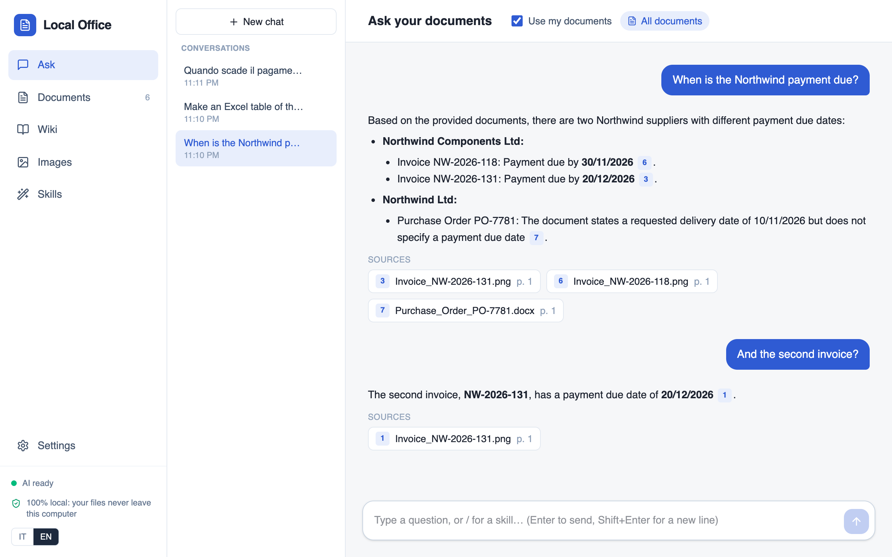
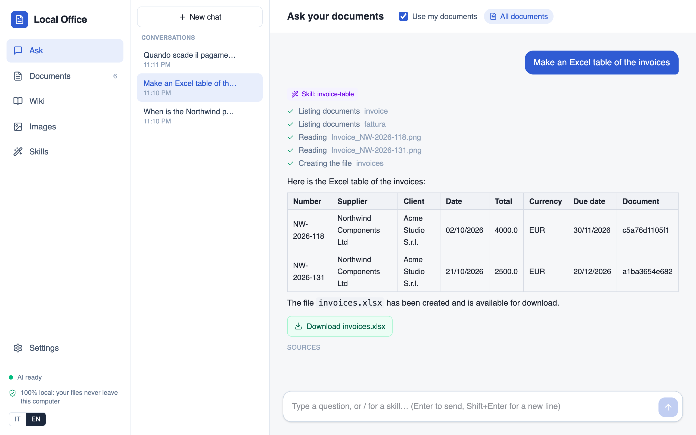
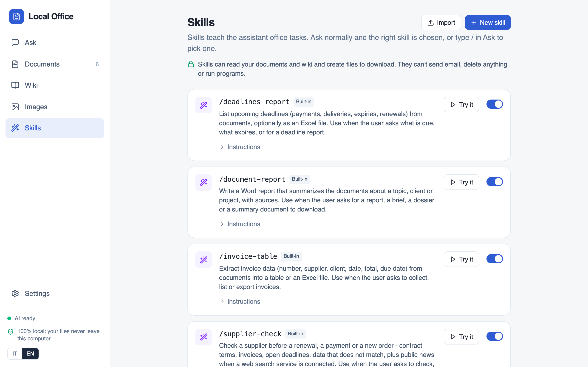
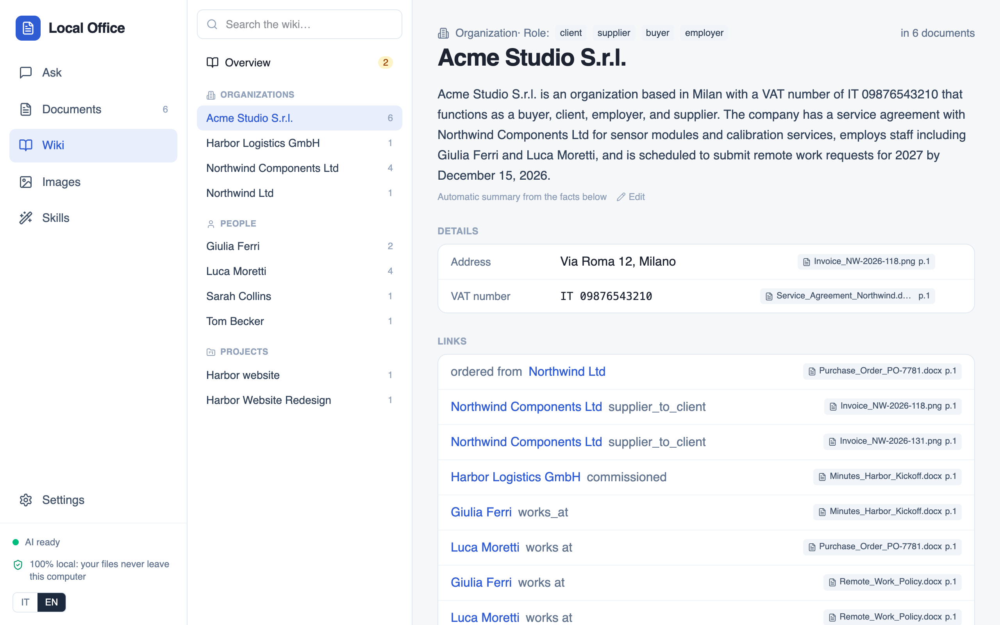

# Local Office

## Windows on Snapdragon

This checkout includes a native Windows ARM64 configuration for Snapdragon X Elite.
Open **Start Local Office.cmd** to launch the desktop app. For a fresh setup, run
`powershell -ExecutionPolicy Bypass -File scripts\setup_snapdragon.ps1` first.
Setup requires ARM64 Python 3.12, uv, and Node.js 22.12+; it downloads the model assets once.
Validated on Windows with a Snapdragon X Elite X1E80100 and 32 GB RAM;
other Qualcomm generations and fresh-machine installs have not been validated.
The Windows shell uses ARM64 Electron with an isolated renderer, a native folder
picker, and a private loopback Python service that stops when the app exits.

| Task | Model | Runtime |
|---|---|---|
| Chat, cited answers, wiki and skills | Qwen3-4B-Instruct-2507 | GenieX QAIRT, NPU |
| Scans and document OCR | LightOnOCR-2-1B Q8_0 + F16 projector | GenieX llama.cpp, NPU |
| Document search embeddings | Nomic-Embed-Text v1.5, 512 dimensions | Qualcomm AI Hub ONNX export, QNN NPU |
| Images and charts | Qwen3-VL-4B-Instruct Q4_0 + F16 projector | GenieX llama.cpp, NPU |

The app uses the verified GenieX 0.10.0 runtime, with `GGML_HEXAGON_DEVICES=HTP0`.
Inference roles take turns in isolated worker processes, avoiding the X Elite
second-session queue failure and collisions between GenieX and ONNX Runtime.
Host preprocessing, sampling and auxiliary vision operators may still use the CPU.
The Nomic session requires NPU placement with CPU fallback disabled.
The Snapdragon backend is selected automatically on Windows ARM64. Set
`LOCAL_OFFICE_BACKEND=llama` when running the regular backend to opt out.

### How this differs from existing Windows x64 support

| | Existing Windows x64 | Windows ARM64 Snapdragon |
|---|---|---|
| Desktop | pywebview / WebView2; existing Inno Setup installer | Electron ARM64; source-checkout launcher |
| Inference transport | OpenAI-compatible HTTP to a `llama-server.exe` per role | JSONL to one isolated Python worker using native runtime APIs |
| Runtime | Official llama.cpp build; CUDA 12.4 by default, CPU fallback; optional Vulkan/CPU builds | GenieX QAIRT for the assistant, GenieX llama.cpp Hexagon for OCR/vision, ONNX Runtime QNN for embeddings |
| Scheduling | Servers start on demand and can stay loaded together | One model role at a time to avoid NPU session conflicts |
| Model roles | Assistant (also handles images), OCR, embeddings | Assistant, OCR, embeddings, separate general vision role |

The Qualcomm path does not launch `llama-server.exe`. OCR and general vision
still use llama.cpp through GenieX's native API. The existing Windows x64 build
scripts, WebView2 entry point, llama-server download/launch arguments and HTTP
inference path are preserved. GenieX/QNN dependencies are an optional
`snapdragon` extra; the x64 installer continues to use the base dependencies.

Regression tests exercise Windows x64/ARM64 backend selection, the ARM64 llama
opt-out, existing saved model compatibility, llama-server supervision routing,
and HTTP completion, image streaming and embeddings. HTTP responses and x64
architecture detection are simulated on the ARM64 test machine. A Windows x64
installer launch and NVIDIA/CUDA execution have not been retested on x64 hardware.
The Snapdragon launch scripts explicitly select the Qualcomm backend; use the
regular entry point for the llama opt-out. Keep each backend's data directory
separate because their embedding models and index dimensions differ.

Data is kept in `data/snapdragon/`, model downloads in `models/` and the GenieX
cache, and runtime files in `build/geniex/`. These are excluded from Git. Documents
stay on the computer. Setup and model downloads require an internet connection;
normal inference uses local files. The preinstalled GenieX CLI is not modified.

Windows ARM64 uses exact NumPy cosine search alongside SQLite FTS5 because
sqlite-vec does not publish an ARM64 Windows wheel. This is suitable for small
office libraries; very large indexes will benefit from a native vector extension.

To run the API and UI without the desktop window:

```powershell
scripts\start_snapdragon.ps1 -ServerOnly -Port 8765
# Open http://127.0.0.1:8765
```

Validation commands:

```powershell
cd backend
.venv\Scripts\python.exe -m pytest -q
cd ..\frontend
npm run build
```

`scripts/check_snapdragon.py` exercises the actual installed models;
`scripts/smoke_app.py` checks OCR ingestion, cited answers, wiki extraction and
an Excel export against a running server using a labeled synthetic invoice.
Set `MODELS_DIR` to this checkout's `models` directory for standalone checks.
Image understanding remains probabilistic: use the OCR/document workflow for
exact transcription and verify cited source pages for important facts.

---

Private AI for the office, as a native Mac app. Drop in paper scans, PDFs, photos and Office files, then ask questions and get answers that cite the exact page. A built-in wiki (your "second brain") compiles what your documents say about companies, people and deadlines. Everything runs on the Mac, and no file leaves the computer.



## Features

- **Documents:** drag & drop PDFs, scans, photos (JPG, PNG, HEIC), TIFF, Word, Excel and text. Digital PDFs use their text layer; scans and photos go through OCR. Tables are kept.
- **Folders:** connect local or shared folders; they stay in sync, strictly read-only.
- **Skills:** folders with a `SKILL.md` ([Agent Skills format](https://docs.claude.com/en/docs/agents-and-tools/agent-skills/overview)) that teach the assistant an office task: deadline reports, invoice tables, Word reports. Ask normally and the right skill is picked, or type `/` to choose one. Skills read documents and the wiki and can create Word, Excel or Markdown files; they never send email, delete anything or run scripts. Create your own in the app or import a `SKILL.md` / `.zip`.
- **Ask:** answers cite the page they come from; click a citation to open the page. Conversations are saved and can be reopened.
- **Wiki:** pages for organizations, people and projects, built from the documents. Every fact links to its source page. Conflicting values (e.g. two VAT numbers) and likely duplicates go to a review list. Exports to Obsidian.
- **Images:** describe photos, read charts, extract tables.
- **Models for your Mac:** the app picks the best models for the Mac's memory. You can switch any of them in Settings, including any GGUF model from Hugging Face. Each model is tested before it's switched on.
- **Italian and English** interface.

| A skill at work | Skills | Wiki |
|---|---|---|
|  |  |  |

## Install

1. Download **LocalOffice.dmg** from [Releases](https://github.com/mfranzon/local-office/releases), open it and drag **Local Office** into Applications.
2. Open it. The first time, it downloads the AI models chosen for your Mac (5–8.5 GB, once). After that it works offline.

Requirements: Apple Silicon Mac, macOS 14+, 16 GB of memory (24 GB for the best assistant model).

> Builds signed only on the build machine (ad-hoc) show a warning on other Macs: System Settings → Privacy & Security → *Open Anyway*. To distribute without warnings, sign and notarize with an Apple Developer ID (see [Build](#build)).

## How it works

```
Local Office.app
├─ native window (WebKit) ── UI (React)
├─ Python backend (FastAPI, SQLite + sqlite-vec + FTS5) on a private localhost port
└─ llama-server (bundled, Metal) ── one process per role, started on first use, stopped when idle
```

| Role | 24 GB+ | 16 GB | Memory in use (measured on an M5) |
|---|---|---|---|
| Answers, chat, images, skills | Qwen3.5 9B | Qwen3.5 4B | 7.5 GB / 4.9 GB |
| OCR of scanned pages | LightOnOCR-2 1B | LightOnOCR-2 1B | ~2.5 GB |
| Search index | Qwen3-Embedding 0.6B | Qwen3-Embedding 0.6B | ~1.2 GB |

- **Data:** the database, files, models and logs live in `~/Library/Application Support/Local Office/`.
- **Search:** pages are split into chunks and embedded. Vector search (sqlite-vec) and keyword search (FTS5) are combined.
- **Wiki:** the assistant extracts facts into a fixed JSON schema. Code then checks every fact against the source text (names, identifiers and dates must appear in it), resolves entities by name and VAT/tax code, and merges them.
- **Skills:** the assistant first picks a skill from names and descriptions only (18/18 correct on an English and Italian test set, 0.5–0.8 s), then follows the skill's instructions with tool calls (search, list and read documents, wiki pages, deadlines, create file). Answers cite their sources.
- **Models:** files are downloaded from Hugging Face with resume. A model switch runs download → start → test → swap, and the current model stays if any step fails.

## Build

```bash
packaging/build_app.sh          # -> dist/LocalOffice.dmg (llama.cpp is built from source on the first run)
# Signed and notarized:
SIGN_IDENTITY="Developer ID Application: …" NOTARY_PROFILE=<notarytool profile> packaging/build_app.sh
```

Needs Xcode command line tools, cmake, ninja, Node 22 and [uv](https://docs.astral.sh/uv/). llama.cpp is pinned in `packaging/build_llama.sh` to the version the models were tested with.

## Development

```bash
cd frontend && npm ci && npm run build                           # UI, served by the backend from frontend/dist
cd backend && uv run uvicorn app.main:app --reload --port 8000    # API + UI on http://localhost:8000
cd frontend && npm run dev                                        # UI with hot reload on :5173 (proxies /api to :8000)
cd backend && uv run python -m app.desktop                        # the app window, from source
cd backend && uv run pytest                                       # tests
uv run scripts/make_demo.py                                       # English demo documents in samples/demo
```

Running from source needs a `llama-server` binary: `packaging/build_llama.sh` builds one into `build/bin`, or set `LLAMA_SERVER`. `DATA_DIR` and `MODELS_DIR` override the data and model folders, which is useful to reuse models you've already downloaded.

```
backend/app/     FastAPI app: ingest (OCR, chunking), rag, wiki, sources (folders), skills + agent + tools,
                 models + runtime (llama-server supervisor), desktop entry point
skills/          built-in skills (SKILL.md), bundled with the app
backend/tests/   pytest suite (no models needed)
frontend/src/    React + Vite + Tailwind UI (views/, components/, i18n.tsx)
packaging/       llama.cpp build, PyInstaller spec, app signing and DMG, Linux .deb, Windows installer
scripts/         sample and demo document generators
```

## Linux (Ubuntu 24.04)

There is no Linux package: build it from source. Tested on Ubuntu 24.04 with an NVIDIA RTX 3060 (6 GB).

```bash
# 1. Build tools, the window's GTK/WebKit, and CUDA (skip nvidia-cuda-toolkit and g++-12 without an NVIDIA GPU)
sudo apt install git cmake ninja-build build-essential python3-gi gir1.2-gtk-3.0 gir1.2-webkit2-4.1 \
  nvidia-cuda-toolkit g++-12
curl -LsSf https://astral.sh/uv/install.sh | sh        # uv; Node 22 with npm from https://nodejs.org or nvm

# 2. Build
git clone https://github.com/mfranzon/local-office.git && cd local-office
packaging/build_llama.sh                               # llama-server with CUDA if nvcc is found, CPU otherwise
(cd frontend && npm ci && npm run build)
cd backend
uv venv --python /usr/bin/python3.12 --system-site-packages   # sees the system's GTK bindings (python3-gi)
uv sync

# 3. Run
uv run python -m app.desktop                           # the app window
uv run uvicorn app.main:app --port 8000                # or: no window, open http://localhost:8000
```

The first start downloads the models (about 5 GB). Data and models live in `~/.local/share/local-office/`. When the GPU
can't hold all three models, OCR and the search index run on the CPU so the assistant keeps the GPU (about 80 tokens/s
for the 4B model on the RTX 3060). `packaging/build_deb.sh` packs the build into a `.deb` for your own machines.

## Windows (10/11, x64)

**LocalOffice-Setup.exe** on [Releases](https://github.com/mfranzon/local-office/releases) installs the app for the
current user (no administrator rights needed). It isn't code-signed yet, so SmartScreen shows *Windows protected your
PC*: *More info* → *Run anyway*. Data and models live in `%LOCALAPPDATA%\Local Office\`.

llama-server is llama.cpp's official Windows build with CUDA 12.4: it uses an NVIDIA GPU (driver only, no CUDA toolkit
needed) and falls back to the CPU without one. The window uses WebView2, which ships with Windows 11 and current
Windows 10.

Build the installer on Windows with uv, Node 22 and [Inno Setup 6](https://jrsoftware.org/isinfo.php):

```powershell
packaging\build_windows.ps1    # -> dist\LocalOffice-Setup.exe; LLAMA_WIN_BACKEND=vulkan or cpu for a smaller build
```

## Status

Early stage, tested on Apple M5 with 24 GB. Small local models make mistakes: answers cite their sources so they can be checked, and wiki facts can be rejected or edited.

## License

[MIT](LICENSE). The AI models are downloaded from Hugging Face at first run and keep their own licenses (Qwen3.5, Qwen3-Embedding and LightOnOCR-2: Apache 2.0; EmbeddingGemma: Gemma Terms of Use).
