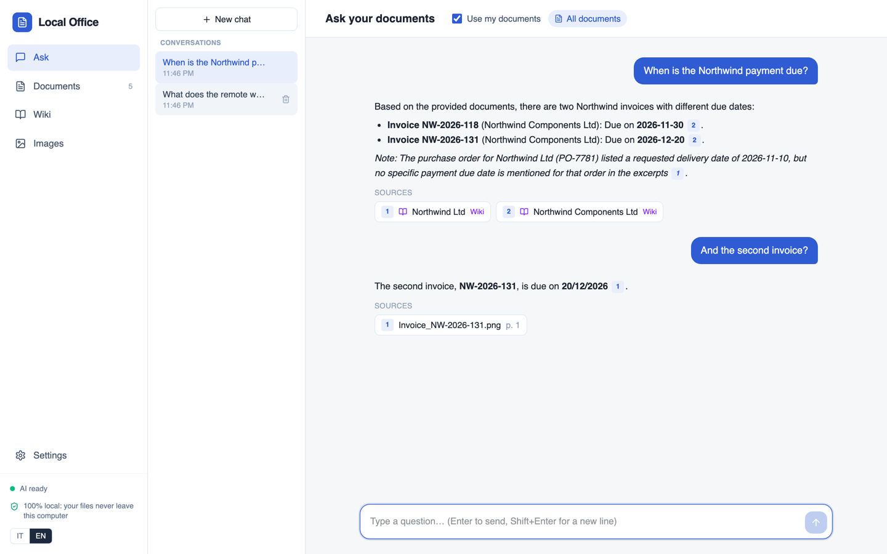
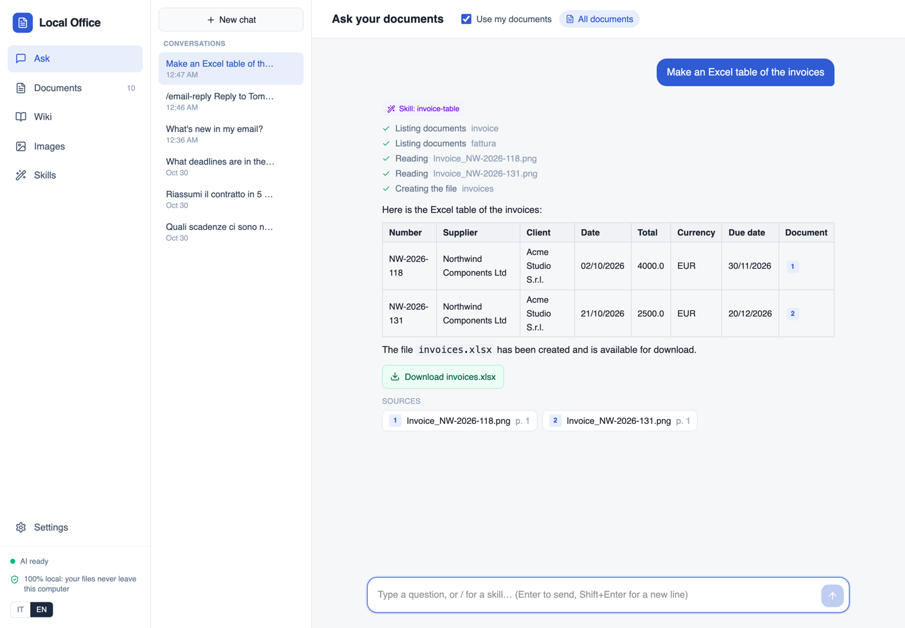
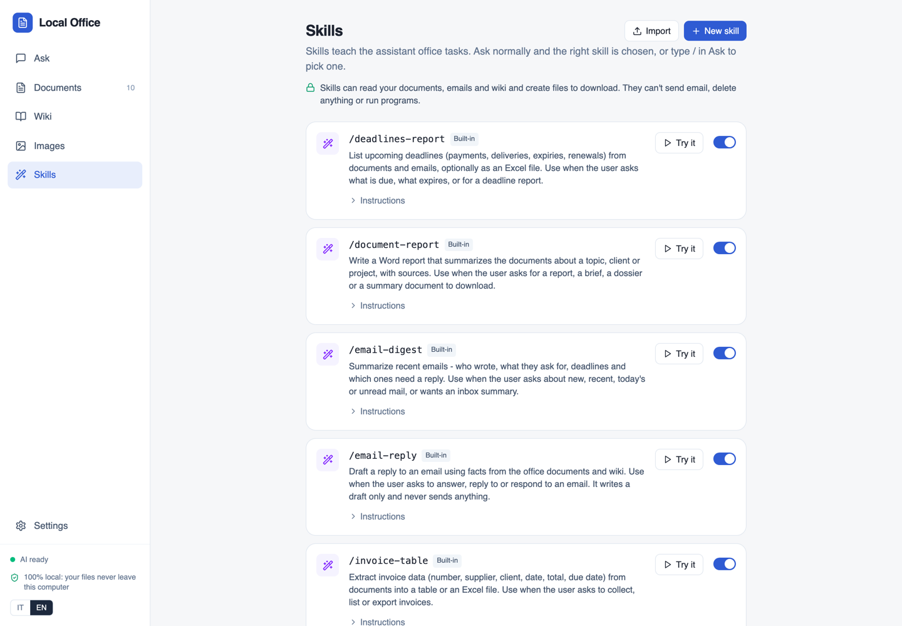
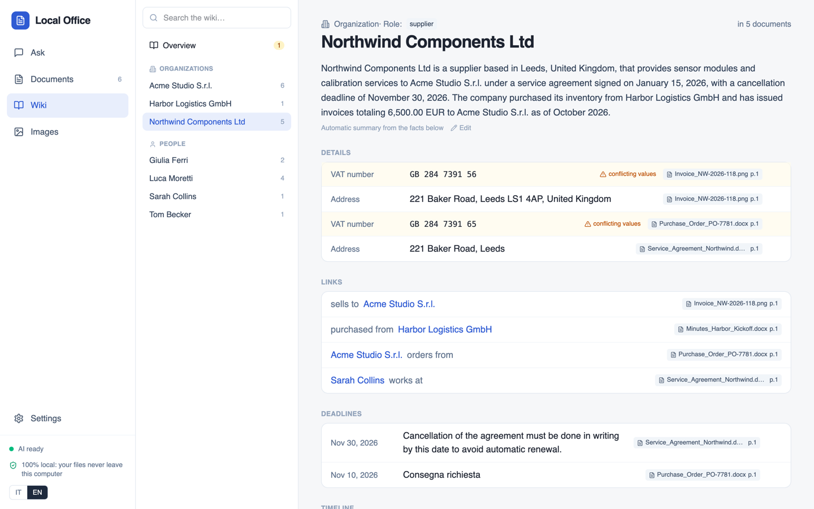

# Local Office

Private AI for the office, as a native Mac app. Drop in paper scans, PDFs, photos and Office files, then ask questions and get answers that cite the exact page. A built-in wiki (your "second brain") compiles what your documents say about companies, people and deadlines. Everything runs on the Mac, and no file leaves the computer.



## Features

- **Documents:** drag & drop PDFs, scans, photos (JPG, PNG, HEIC), TIFF, Word, Excel and text. Digital PDFs use their text layer; scans and photos go through OCR. Tables are kept.
- **Folders:** connect local or shared folders; they stay in sync, strictly read-only.
- **Skills:** folders with a `SKILL.md` ([Agent Skills format](https://docs.claude.com/en/docs/agents-and-tools/agent-skills/overview)) that teach the assistant an office task: deadline reports, invoice tables, Word reports. Ask normally and the right skill is picked, or type `/` to choose one. Skills read documents and the wiki and can create Word, Excel or Markdown files; they never send email, delete anything or run scripts. Create your own in the app or import a `SKILL.md` / `.zip`.
- **Ask:** answers cite the page they come from; click a citation to open the page. Conversations are saved and can be reopened.
- **Wiki:** pages for organizations, people and projects, built from the documents. Every fact links to its source page. Conflicting values (e.g. two VAT numbers) and likely duplicates go to a review list. Exports to Obsidian.
- **Images:** describe photos, read charts, extract tables.
- **Models for your Mac:** the app picks the best models for the Mac's memory. You can switch any of them in Settings, including any GGUF model from Hugging Face. Each model is tested before it's switched on.
- **Italian and English** interface.

| A skill at work | Skills | Wiki |
|---|---|---|
|  |  |  |

## Install

1. Download **LocalOffice.dmg** from [Releases](https://github.com/mfranzon/local-office/releases), open it and drag **Local Office** into Applications.
2. Open it. The first time, it downloads the AI models chosen for your Mac (5–8.5 GB, once). After that it works offline.

Requirements: Apple Silicon Mac, macOS 14+, 16 GB of memory (24 GB for the best assistant model).

> Builds signed only on the build machine (ad-hoc) show a warning on other Macs: System Settings → Privacy & Security → *Open Anyway*. To distribute without warnings, sign and notarize with an Apple Developer ID (see [Build](#build)).

## How it works

```
Local Office.app
├─ native window (WebKit) ── UI (React)
├─ Python backend (FastAPI, SQLite + sqlite-vec + FTS5) on a private localhost port
└─ llama-server (bundled, Metal) ── one process per role, started on first use, stopped when idle
```

| Role | 24 GB+ | 16 GB | Memory in use (measured on an M5) |
|---|---|---|---|
| Answers, chat, images, skills | Qwen3.5 9B | Qwen3.5 4B | 7.5 GB / 4.9 GB |
| OCR of scanned pages | LightOnOCR-2 1B | LightOnOCR-2 1B | ~2.5 GB |
| Search index | Qwen3-Embedding 0.6B | Qwen3-Embedding 0.6B | ~1.2 GB |

- **Data:** the database, files, models and logs live in `~/Library/Application Support/Local Office/`.
- **Search:** pages are split into chunks and embedded. Vector search (sqlite-vec) and keyword search (FTS5) are combined.
- **Wiki:** the assistant extracts facts into a fixed JSON schema. Code then checks every fact against the source text (names, identifiers and dates must appear in it), resolves entities by name and VAT/tax code, and merges them.
- **Skills:** the assistant first picks a skill from names and descriptions only (18/18 correct on an English and Italian test set, 0.5–0.8 s), then follows the skill's instructions with tool calls (search, list and read documents, wiki pages, deadlines, create file). Answers cite their sources.
- **Models:** files are downloaded from Hugging Face with resume. A model switch runs download → start → test → swap, and the current model stays if any step fails.

## Build

```bash
packaging/build_app.sh          # -> dist/LocalOffice.dmg (llama.cpp is built from source on the first run)
# Signed and notarized:
SIGN_IDENTITY="Developer ID Application: …" NOTARY_PROFILE=<notarytool profile> packaging/build_app.sh
```

Needs Xcode command line tools, cmake, ninja, Node 22 and [uv](https://docs.astral.sh/uv/). llama.cpp is pinned in `packaging/build_llama.sh` to the version the models were tested with.

## Development

```bash
cd frontend && npm ci && npm run build                           # UI, served by the backend from frontend/dist
cd backend && uv run uvicorn app.main:app --reload --port 8000    # API + UI on http://localhost:8000
cd frontend && npm run dev                                        # UI with hot reload on :5173 (proxies /api to :8000)
cd backend && uv run python -m app.desktop                        # the app window, from source
cd backend && uv run pytest                                       # tests
uv run scripts/make_demo.py                                       # English demo documents in samples/demo
```

Running from source needs a `llama-server` binary: `packaging/build_llama.sh` builds one into `build/bin`, or set `LLAMA_SERVER`. `DATA_DIR` and `MODELS_DIR` override the data and model folders, which is useful to reuse models you've already downloaded.

### Linux (from source)

Tested on Ubuntu 24.04 with an RTX 3060 (6 GB). `packaging/build_llama.sh` builds llama-server with CUDA when `nvcc` is
installed (CPU otherwise), then run the backend as above and open http://localhost:8000. Data lives in
`~/.local/share/local-office/`. When the GPU can't hold all three models, OCR and the search index run on the CPU so the
assistant keeps the GPU (~80 tokens/s for the 4B model on the 3060).

```
backend/app/     FastAPI app: ingest (OCR, chunking), rag, wiki, sources (folders), skills + agent + tools,
                 models + runtime (llama-server supervisor), desktop entry point
skills/          built-in skills (SKILL.md), bundled with the app
backend/tests/   pytest suite (no models needed)
frontend/src/    React + Vite + Tailwind UI (views/, components/, i18n.tsx)
packaging/       llama.cpp build, PyInstaller spec, app signing and DMG
scripts/         sample and demo document generators
```

## Status

Early stage, tested on Apple M5 with 24 GB. Small local models make mistakes: answers cite their sources so they can be checked, and wiki facts can be rejected or edited.

## License

[MIT](LICENSE). The AI models are downloaded from Hugging Face at first run and keep their own licenses (Qwen3.5, Qwen3-Embedding and LightOnOCR-2: Apache 2.0; EmbeddingGemma: Gemma Terms of Use).
